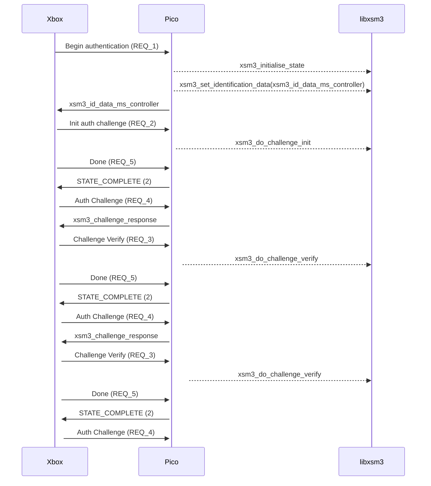

# libxsm3

A "library" for completing Xbox Security Method 3 challenges used by the Xbox 360 video game console to authenticate controllers.

## What this does

This library allows an Xbox 360 controller emulator to authenticate with retail consoles.

## TODO

- Make sure this is able to work on embedded platforms (e.g. Pi Pico).
- Document more of the values used in the identification packet.
- Unit tests and being able to verify packets from a controller to be valid.

## Uses

libxsm3 is used in the [Santroller](https://github.com/santroller/santroller) and [portal_of_flipper](https://github.com/sanjay900/portal_of_flipper) projects.

## Credits

- [oct0xor](https://github.com/oct0xor) for reversing, documenting and implementing much of the process. ([blog post](https://oct0xor.github.io/2017/05/03/xsm3/), [source code](https://github.com/oct0xor/xbox_security_method_3))
- [emoose](https://github.com/emoose) for reimplementing many of the XeCrypt functions in [ExCrypt](https://github.com/emoose/ExCrypt).
- [sanjay900](https://github.com/sanjay900) and an anonymous contributor for helping discover the retail keys.

## License 

libxsm3 is licensed under the GNU Lesser General Public License version 2.1, or (at your option) any later version.

This project uses [ExCrypt](https://github.com/emoose/ExCrypt), licensed under the [3-clause BSD license](https://github.com/emoose/ExCrypt/blob/b2e037c3102de22d1107d1e362df4ce407d964ac/LICENSE) - all files included are prefixed with "excrypt".

## Example

Being used in a handler for setup requests for the XSM3 interface descriptor

```c
#include "xsm3.h"
void xsm3_setup_request_handler(usb_setup_request* ctrl) {
    switch (ctrl->bRequest) {
        case 0x81:
            xsm3_initialise_state();
            xsm3_set_identification_data(xsm3_id_data_ms_controller);
            ctrl->send_data(xsm3_id_data_ms_controller);
            break;
        case 0x82:
            xsm3_do_challenge_init(ctrl->in_data);
            break;
        case 0x87:
            xsm3_do_challenge_verify(ctrl->in_data);
            break;
        case 0x83:
            ctrl->send_data(xsm3_challenge_response);
            break;
        case 0x86:
            short state = 2; // 1 = in-progress, 2 = complete
            ctrl->send_data(&state);
            break;
    }
}
```

## Authentication flow

**Important**: The Xbox 360 attempts to re-authenticate at various points during the power cycle. It is therefore 
essential to **persist** the pre-computed authentication values throughout all authentication stages while the 
microcontroller remains connected. Failing to do so will cause the Xbox 360 to treat the microcontroller as 
unauthenticated after a full power cycle.

The authentication flow described below outlines the steps performed by an Xbox 360 Slim (Trinity) before 
recognizing a device as authentic.



Each time the Xbox is powered on, it will attempt to repeat the authentication flow described above. If the previously 
authenticated microcontroller remains connected, it is crucial to reuse the same ```xsm3_id_data_ms_controller``` and 
not call ```xsm3_initialise_state``` again, as this function completely resets the authentication state.